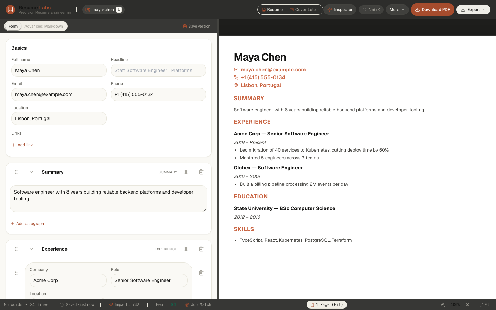
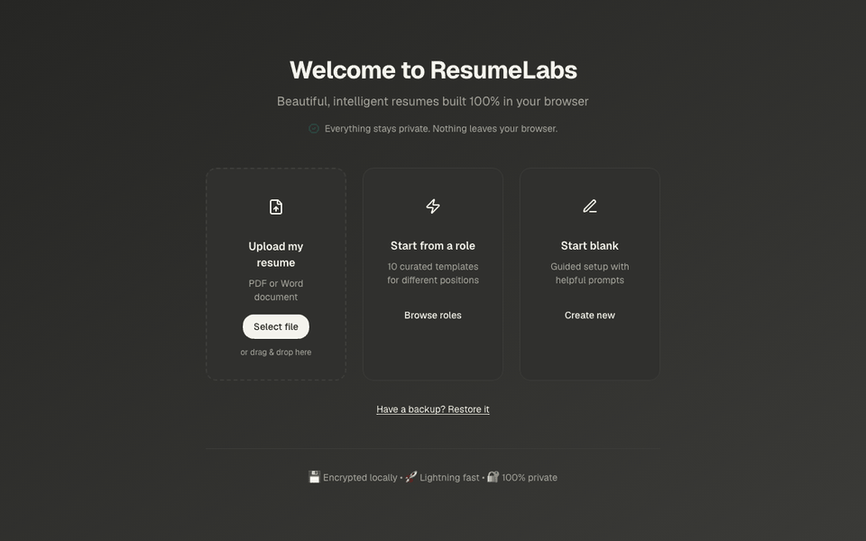
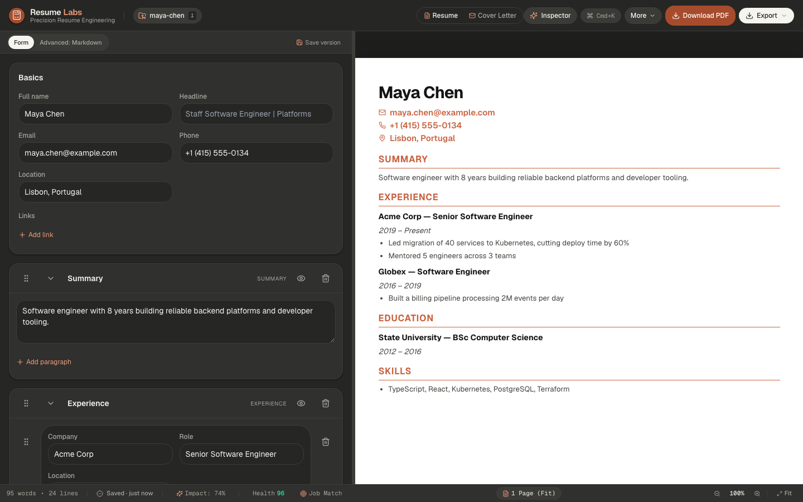
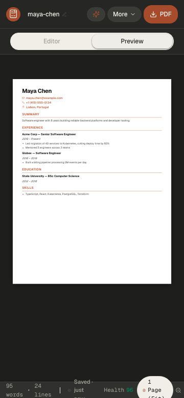
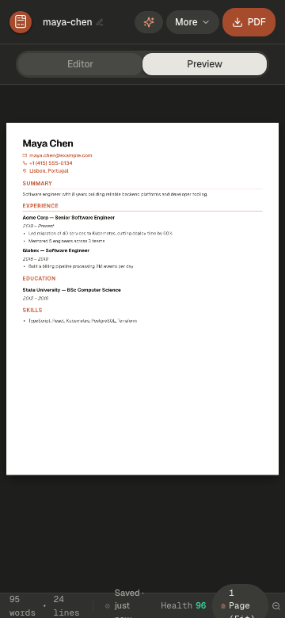

# ResumeLabs

**Build a clear resume, check how it reads to a computer, and download it as a PDF. Everything happens in your browser.**

[**Open ResumeLabs**](https://solondas96.github.io/resume-os/) · [Changelog](CHANGELOG.md) · [Design](docs/DESIGN.md) · [Words we use](docs/COPY.md)





## What it does

1. **Start from what you have.** Upload your resume (PDF, Word, text or Markdown), start from a role, or start with a blank page. Nothing is uploaded: the file is read in your browser.
2. **Check the result.** The preview shows the page as it will be sent. The inspector scores the resume, explains each fix in plain words, and compares it with a job posting.
3. **Download it.** Download PDF makes a file on your device. The text in the file can be selected and read by applicant tracking software. Print is available too.
4. **Keep a copy.** Download a backup at any time. ResumeLabs reminds you after a week. You can restore a backup, and you see what will be added before anything changes.

## Your privacy

- Your resumes are stored only in this browser. Nothing is sent to a server, and there is no account.
- The app makes no network requests after it has loaded, apart from its own files.
- You can delete everything with one action. You are asked to type `DELETE` first.
- The app works offline after the first visit.

## Screenshots

| Desktop, light | Desktop, dark |
| --- | --- |
|  |  |

| Phone, light | Phone, dark |
| --- | --- |
|  |  |

The same screens are rebuilt at 360, 768 and 1440 pixels wide in both themes on every release (see the `screenshots-and-walkthrough` artifact in CI).

## Using it

1. Open the [live app](https://solondas96.github.io/resume-os/).
2. Choose **Upload my resume**, then **Create resume**.
3. Edit in the form. Each section opens into cards you can change, reorder and hide.
4. Press **Inspector** to see the health score, the job match, the page design and your saved versions.
5. Press **Download PDF**.

Press `Cmd+K` (or `Ctrl+K`) to search for any action. Under **More** you will find the resume library, the application tracker, the cover letter, sharing and the shortcuts.

## Running it yourself

You need Node.js 24 (the version this project is built and tested with).

```sh
npm ci
npm run dev            # the app at http://localhost:5173
npm run lint           # type check
npm run test:coverage  # unit tests with the coverage gate
npm run build          # production build in dist/
npm run e2e            # end-to-end tests in a real browser (Playwright)
npm run e2e:build      # the same tests against the production build
npm run e2e:pwa        # the offline test
npm run perf           # first-screen timing on a slow connection
npm run size           # the bundle size budget
```

The first end-to-end run needs the browser: `npx playwright install chromium`.

## How it is checked

These numbers are from the release (commit `63e447d` and the tests in this repository):

| Check | Result |
| --- | --- |
| Unit tests | 373 pass |
| End-to-end tests (Chromium) | 33 pass |
| Offline (PWA) test | passes |
| First screen on Fast 3G with a 4× slower CPU | about 1.9 s (budget 2.5 s) |
| Initial JavaScript, gzipped | 76 kB (budget 300 kB) |
| Import accuracy, six real exports from LibreOffice | 100% |
| Import accuracy, synthetic corpus | 99% |
| Skills dictionary | 11,737 skills, 978 KB (budget 1.5 MB) |
| First-time walkthrough, from first screen to PDF | 5 steps (budget 5) |

The full record of each round is in [docs/PLAN.md](docs/PLAN.md), section 10.

## Known limits

- **Import accuracy is measured on LibreOffice exports and a synthetic set.** Word, Google Docs, Canva and LinkedIn exports are not in the test set yet (see `tests/fixtures/real/MISSING.md`).
- **US Letter is about 6% shorter than A4.** A resume that fits one A4 page is tightened to fit one Letter page. A resume that is longer than one page keeps its spacing, and may run to one more page on Letter.
- **The ESCO skills list is not included.** It needs a download that is sent by email. O\*NET covers the work activities and tools.
- **The first-screen budget is 2.5 s,** not the 2 s first planned. Two network round trips and React set the floor on the simulated slow connection.

## Data and licences

- Skill and occupation names come from **O\*NET 29.1** (CC BY 4.0). The field synonyms, the curated tech list and the copy are written for this project. See [ATTRIBUTIONS.md](ATTRIBUTIONS.md).
- The PDF fonts (Geist and Newsreader) are self-hosted from `public/fonts/`.

## Project layout

- `src/intelligence/` — scoring, job matching, tailoring, the skills dictionary (no React)
- `src/model/` — the resume data model and its Markdown form (no React)
- `src/import/` — reading PDF, Word and text files
- `src/pdf/` — building the PDF
- `src/components/` — the screens
- `docs/` — the plan, the design tokens, the words we use, and the media for this page
- `tests/` — end-to-end tests and the accuracy fixtures
